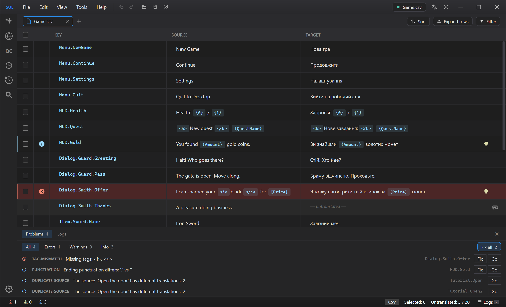
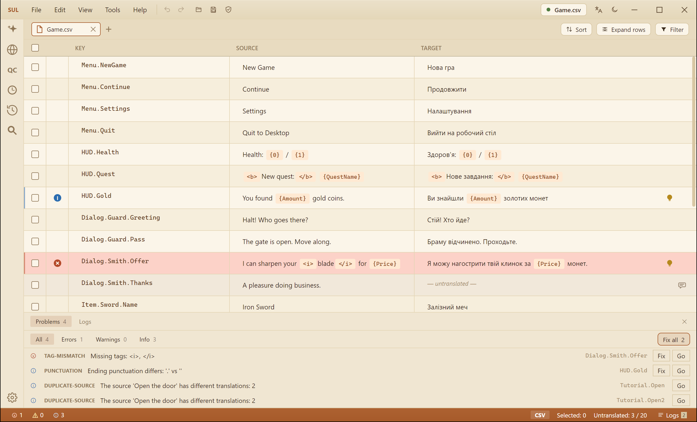
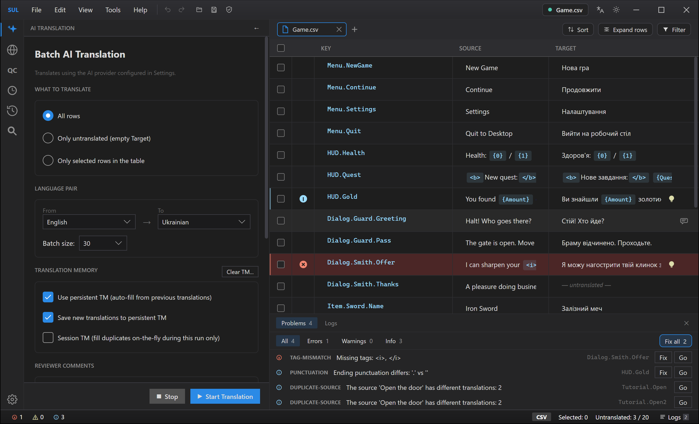

# Smart Unreal Localization

A desktop editor for **Unreal Engine game localization** — open `.locres` /
`.po` / `.csv` files, translate them by hand or with **AI batch translation**,
review the result, and ship files the engine accepts byte-for-byte.

**Version 1.0.0** · Windows 10/11 · [MIT License](LICENSE) · [Changelog](CHANGELOG.md)

Built on **[LocresIO](LocresIO/README.md)** — a first-party, MIT-licensed,
clean-room `.locres` engine. No external tools, no runtime downloads.



## Highlights

- **Every `.locres` version** (v0 Legacy → v3 CityHash64), read and write,
  validated byte-exact against Unreal Engine's own output. Opening a 6k-entry
  file takes ~2 ms; saving ~5 ms.
- **AI batch translation** — Gemini, OpenAI, Anthropic, or any
  OpenAI-compatible endpoint, with your own API key. Batching, prompt caching,
  parallel requests, retry, tag protection (`<Tag>` / `{0}` constructs are never
  mangled), translation memory, protected-terms glossary, and per-row reviewer
  comments that travel to the model as instructions.
- **Multi-language pipeline** — translate one file into N languages in a
  single run, each language written to its own locale folder.
- **Game-update workflow** — "Merge to new version" carries your translations
  onto a new game build: new keys highlighted green, keys whose source text
  changed highlighted violet for re-review.
- **Live validation** — tags, placeholders, plurals, lost line breaks, leftover
  source language, model chatter and your terminology are checked as you type.
  No fix is ever written unseen: every change is shown before → after first.
- **QC review** — an AI second opinion on an already-translated file, with the
  rows and requests it will cost shown before anything is sent.
- **Review workflow** — approve/reject rows, reviewer comments, filters, find &
  replace with highlighting, undo/redo including batch operations.
- **MCP server** — let an AI chat client (Claude Desktop, Claude Code, Codex, …)
  drive the running app, on your chat subscription instead of an API key.
- **Prompt history** — every distinct prompt sent by translation,
  multi-language translation and AI QC is kept and can be reopened and copied.
- **15 interface languages**, light and dark themes, and an accent colour of
  your choice (shades for both themes are worked out from it).
- **Copy what you see** — drag over any Key, Source or Target cell to select
  part of it; a double-click selects a word or a whole key.
- **Safety by design** — atomic saves, untranslated rows never blank shipped
  strings, the engine's stale-translation hashes are preserved, and a crash
  rescues your unsaved edits and leaves a report.

## Screenshots

| Light theme | AI translation |
|---|---|
|  |  |

## Install

1. Download `SmartUnrealLocalization-1.0.0-win-x64.zip` from the
   [Releases page](https://github.com/theworfer/SmartUnrealLocalization/releases)
   (and, if you like, check it against the `.sha256` file next to it).
2. Extract it to a folder you can write to — for example `Documents` or
   `Desktop`, **not** `Program Files`: exports and autosaves go next to the exe by
   default (both folders can be changed in Settings).
3. Run `SmartUnrealLocalization.exe`. Nothing else to install — the .NET runtime
   is inside the exe. **Help → Check for updates** tells you when a newer
   release is out (it checks only when you click it).

The exe is not code-signed yet, so Windows SmartScreen may warn on the first
start: choose **More info → Run anyway**. On a PC with **Smart App Control**
turned on, Windows blocks unsigned programs outright and offers no "run anyway" —
see [Troubleshooting](docs/TROUBLESHOOTING.md).

## Getting started

1. **Open** a `.locres` file (File → Open, or drag it onto the window or the
   exe). The format version shows in the
   title pill; Namespace and Key appear as separate columns.
2. **Translate** — type into Target, paste columns from Excel, or open
   **AI Translate** (set your API key, model and language pair in Settings
   first). Rows with reviewer comments send them to the model as context.
3. **Save** — the save button writes a timestamped folder under your Export
   directory; Save As can also ask for an exact path (Settings → Files).

## Documentation

- [User guide](docs/USER-GUIDE.md) ([українською](docs/USER-GUIDE.uk.md)) — also
  under Help → Documentation in the app
- [FAQ](docs/FAQ.md) · [Troubleshooting](docs/TROUBLESHOOTING.md)
- [LocresIO library](LocresIO/README.md) · [.locres format spec](LocresIO/FORMAT.md) · [benchmarks](LocresIO/BENCHMARKS.md)
- For developers: [Architecture](docs/ARCHITECTURE.md) · [Contributing](CONTRIBUTING.md)

## Build from source

```powershell
dotnet build    # .NET 8 SDK; 0 warnings policy
dotnet test
powershell -ExecutionPolicy Bypass -File tools/publish-release.ps1   # release zip
```

## License

Smart Unreal Localization, including the LocresIO library, is open source under
the [MIT License](LICENSE). It uses third-party open-source components, each under
its own license — the full list is in [THIRD-PARTY-NOTICES.txt](THIRD-PARTY-NOTICES.txt),
with license texts in [licenses/](licenses/). The same texts are in the app under
Help → Licenses.

"Unreal" and "Unreal Engine" are trademarks of Epic Games, Inc. This project is
not affiliated with or endorsed by Epic Games.
